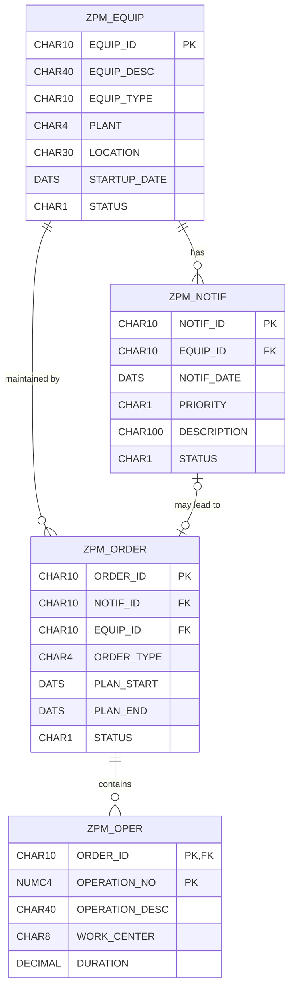

# Database Design — Proposed Custom Tables

## 1. Design note

The following is a conceptual relational design for a learning project. These tables do not exist in an SAP system yet. Field definitions, key design, client dependency, data elements, domains, and foreign-key checks must be finalised in ABAP Dictionary before implementation.

The names use the customer namespace prefix `ZPM_` as proposed custom objects.

## 2. Entity relationship overview

## 3. Proposed table definitions

### ZPM_EQUIP — Equipment

| Field | Suggested type | Key | Description |
|---|---|---|---|
| EQUIP_ID | CHAR(10) | Primary | Unique learning-project equipment ID |
| EQUIP_DESC | CHAR(40) | | Equipment description |
| EQUIP_TYPE | CHAR(10) | | Equipment category |
| PLANT | CHAR(4) | | Plant identifier |
| LOCATION | CHAR(30) | | Physical location |
| STARTUP_DATE | DATS | | Date placed into service |
| STATUS | CHAR(1) | | A = Active; I = Inactive |

### ZPM_NOTIF — Maintenance Notification

| Field | Suggested type | Key | Description |
|---|---|---|---|
| NOTIF_ID | CHAR(10) | Primary | Unique notification ID |
| EQUIP_ID | CHAR(10) | Foreign | Related equipment |
| NOTIF_DATE | DATS | | Date reported |
| PRIORITY | CHAR(1) | | Project-defined priority |
| DESCRIPTION | CHAR(100) | | Reported problem |
| STATUS | CHAR(1) | | O = Open; P = Processing; C = Closed |

### ZPM_ORDER — Maintenance Order

| Field | Suggested type | Key | Description |
|---|---|---|---|
| ORDER_ID | CHAR(10) | Primary | Unique learning-project order ID |
| NOTIF_ID | CHAR(10) | Foreign, optional | Related notification |
| EQUIP_ID | CHAR(10) | Foreign | Related equipment |
| ORDER_TYPE | CHAR(4) | | Project-defined order category |
| PLAN_START | DATS | | Planned start date |
| PLAN_END | DATS | | Planned end date |
| STATUS | CHAR(1) | | C = Created; R = Released; P = In Progress; T = Technically Completed |

### ZPM_OPER — Maintenance Operation

| Field | Suggested type | Key | Description |
|---|---|---|---|
| ORDER_ID | CHAR(10) | Primary, foreign | Related maintenance order |
| OPERATION_NO | NUMC(4) | Primary | Operation sequence |
| OPERATION_DESC | CHAR(40) | | Work-step description |
| WORK_CENTER | CHAR(8) | | Work centre identifier |
| DURATION | DEC(5,1) | | Planned duration in hours |

## 4. Relationships

- One equipment item can have multiple notifications.
- One equipment item can have multiple maintenance orders.
- A notification may be referenced by an order. The exact cardinality and uniqueness rule should be confirmed during implementation.
- One order can contain multiple operations.

## 5. Important SAP distinction

This is a custom learning data model. SAP PM standard data is represented by standard SAP objects and tables, with relationships and status handling more sophisticated than this proposal. Do not describe these custom tables as replacements for standard SAP PM tables.
